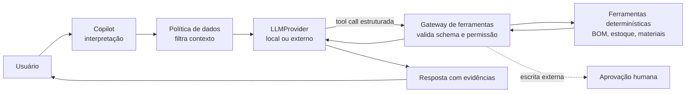

# EngiFlow — Arquitetura de IA (AI Copilot)

Status: **Proposta** (Fase 0). Implementação na Fase 7.

## Papel da IA

Camada de **assistência**: interpreta pedidos, sugere classificações, explica divergências, recomenda automações, prepara planos e pede informações faltantes. Não calcula, não inventa códigos, não executa escrita externa diretamente.

## Princípios

1. Provedor independente: interface `LLMProvider` com implementações para provedor externo e local (Ollama). Política da organização define quais estão habilitados.
2. Cálculos críticos (quantidades, necessidades, faltas) são funções determinísticas. A IA apenas chama essas ferramentas.
3. **Tool calling estruturado:** o modelo só pode chamar ferramentas do catálogo, com parâmetros validados por schema. Nenhum SQL livre, nenhum comando, nenhum script.
4. Respostas com evidência: cada afirmação sobre dado aponta para registro, documento, revisão e página, ou é marcada como não verificada.
5. Conteúdo recuperado (documentos, planilhas, descrições) é **dado**. Instruções dentro de documentos são ignoradas e exibidas ao usuário como conteúdo suspeito.
6. Escrita em sistemas externos exige aprovação humana explícita; a IA nunca tem essa permissão por si só.

## Fluxo

## Política de dados para IA

- Provedor externo: somente dados sintéticos ou dados explicitamente autorizados pela organização. Por padrão, **nenhum dado industrial real**.
- Provedor local: permitido para dados internos, sujeito à mesma RBAC do usuário.
- Contexto enviado é mínimo, mascarado e registrado (hash + categoria, não o conteúdo integral).
- Retenção do provedor e uso para treinamento devem ser verificados contratualmente antes de habilitar qualquer provedor externo (pendente).

## Recuperação (RAG) — Fase 7

- Busca textual primeiro (PostgreSQL full text). Busca semântica com pgvector depois, por documento e revisão.
- Chunks guardam documento, revisão e página.
- Permissão é verificada na recuperação, não só na resposta.

## Avaliação

Antes de habilitar uma capacidade de IA em produção:

- Conjunto de perguntas sintéticas com resposta esperada.
- Medição de respostas que citam dado inexistente (alucinação) — meta a definir, sem prometer valor.
- Revisão humana das sugestões de classificação e equivalência.

## Riscos residuais

- Modelo pode sugerir classificação plausível e errada. Mitigação: sugestão sempre com score, evidência e revisão humana.
- Custo e latência de provedor externo. A medir.

## Pendências

Escolha de provedor(es), hardware para modelo local, política jurídica de dados. Ver `decisions/OPEN_QUESTIONS.md`.
