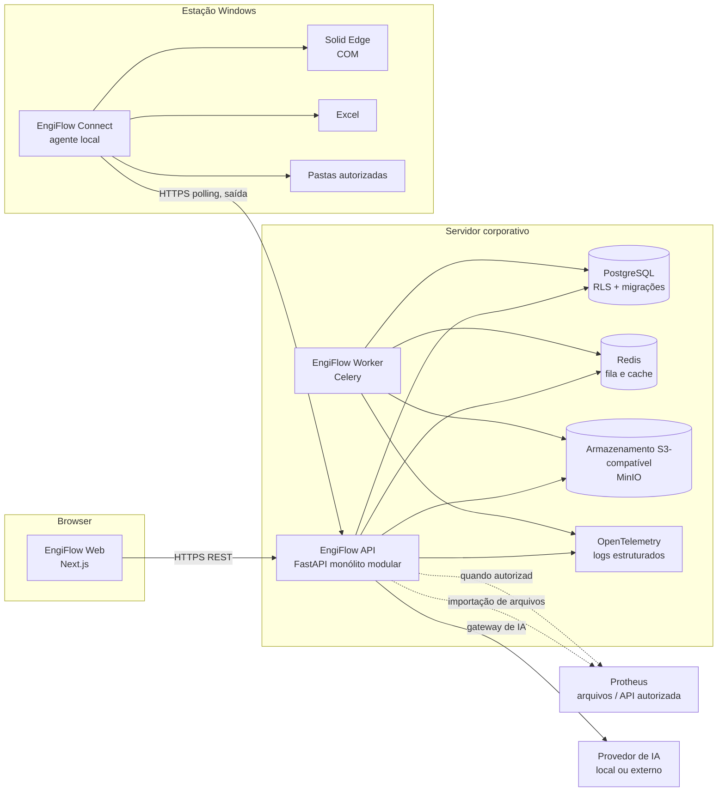
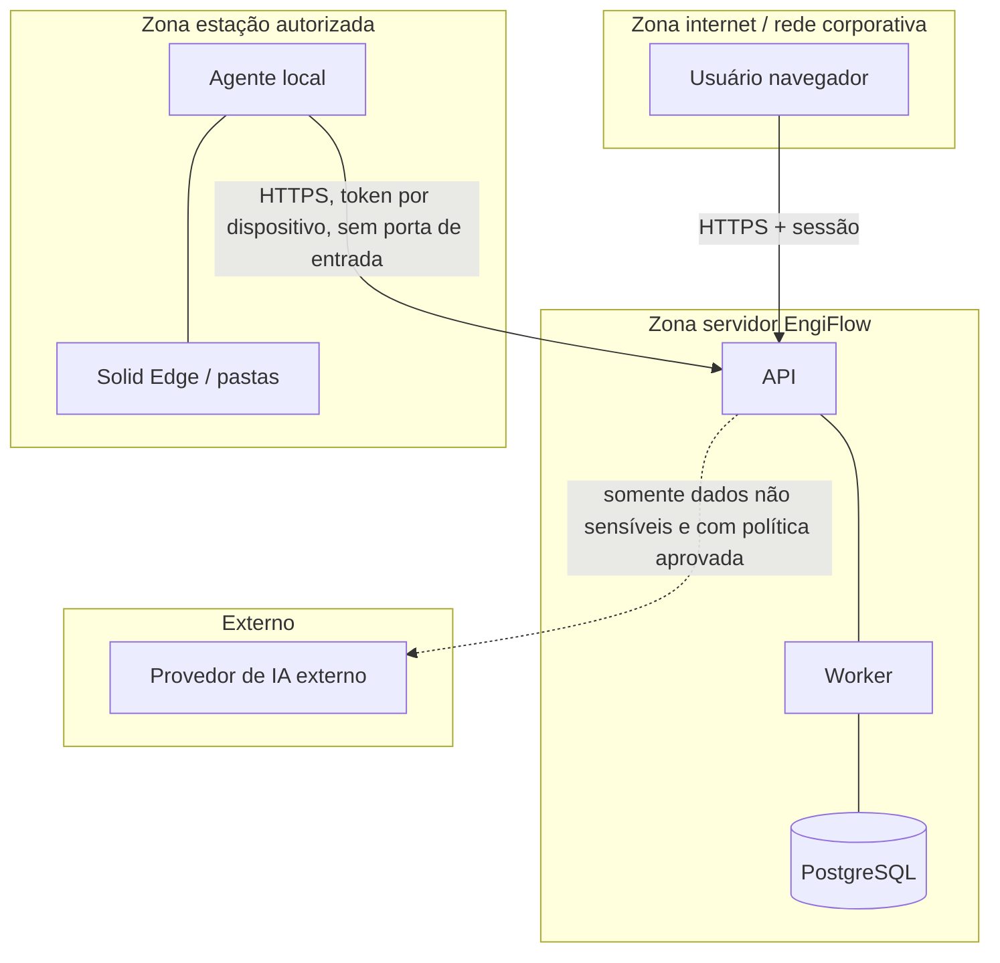

# EngiFlow — Arquitetura geral

Status: **Proposta para revisão** (Fase 0). Decisões formalizadas em `decisions/`.

## 1. Estilo

**Monólito modular** para API e domínio, com **workers assíncronos** e um **agente local Windows** separado. Sem microsserviços nesta fase (ADR-0001).

Cada módulo de domínio segue arquitetura hexagonal: `domain` sem dependência de frameworks; `application` com casos de uso; `infrastructure` com adaptadores (SQLAlchemy, conectores); `presentation` com rotas FastAPI.

## 2. Aplicações

| Aplicação | Responsabilidade | Tecnologia proposta |
|---|---|---|
| `apps/web` | UI: dashboard, projetos, BOM, materiais, Data Studio, automações, relatórios, admin | Next.js, React, TS strict, Tailwind, shadcn/ui |
| `apps/api` | Autenticação, regras de negócio, persistência, APIs REST, auditoria | Python, FastAPI, Pydantic, SQLAlchemy, Alembic |
| `apps/worker` | Importações grandes, exportações, expansão de BOM em lote, execução de workflows, retentativas | Celery + Redis (ver ADR-0004) |
| `apps/local-agent` | Conectores Windows (Solid Edge COM, Excel, pastas autorizadas) com saída HTTPS | Python (PyWin32) ou C#/.NET se justificado |

## 3. Módulos de domínio (em `apps/api`)

`organizations` · `identity` (usuários, papéis, permissões) · `projects` · `materials` · `boms` · `inventory` · `data_studio` · `documents` · `revisions` · `connectors` · `agents` · `jobs` · `workflows` · `approvals` · `audit` · `analytics` · `ai`

Dependência permitida: módulo de aplicação → `domain` de outros módulos via interfaces públicas. Nenhum módulo importa `infrastructure` de outro.

## 4. Diagrama de componentes

## 5. Fronteiras de segurança

Cruzamento Z2 → Z4 é bloqueado por padrão (ver `SECURITY_MODEL.md`).

## 6. Escolhas de stack com justificativa resumida

| Escolha | Justificativa | Alternativa considerada |
|---|---|---|
| Monólito modular | Equipe pequena, domínio ainda em descoberta | Microsserviços (rejeitado: custo operacional prematuro) |
| PostgreSQL | Transações, constraints, RLS, JSONB para metadados | MySQL (sem RLS nativo) |
| FastAPI + Pydantic | Ecossistema Pandas/OpenPyXL/RapidFuzz em Python | Node/NestJS (exigiria duplicar processamento de dados) |
| Celery + Redis | Padrão da stack pedida; retentativas e agendamento prontos | RQ, Dramatiq, fila em PostgreSQL com `SKIP LOCKED` (ver ADR-0004) |
| Agente em Python | PyWin32 e COM maduros; mesma linguagem do backend para contratos | C#/.NET (reservado para conectores que exijam, ver ADR-0005) |
| Next.js + shadcn | Stack pedida; componentes acessíveis | — |

## 7. Escalabilidade

- API stateless: escala horizontal atrás de balanceador.
- Workers: escala horizontal por fila.
- Agente: uma instância por estação; tarefas com lease evitam execução dupla.
- Banco: escala vertical primeiro; leitura analítica separada só se medição justificar.

Não há metas numéricas de capacidade até medição com volume real.

## 8. Riscos arquiteturais principais

Ver `decisions/OPEN_QUESTIONS.md` e `THREAT_MODEL.md`. Os de maior impacto:

1. Escrita em CAD por manipulação binária (contrária à diretriz do prompt) — ver ADR-0005.
2. Vazamento de dados industriais para serviços de IA externos — ver ADR-0009.
3. Dependência de Solid Edge COM exigir sessão Windows interativa e licença — ver `LOCAL_AGENT_DESIGN.md`.
4. Ausência de endpoints Protheus conhecidos — ver `INTEGRATION_STRATEGY.md`.
