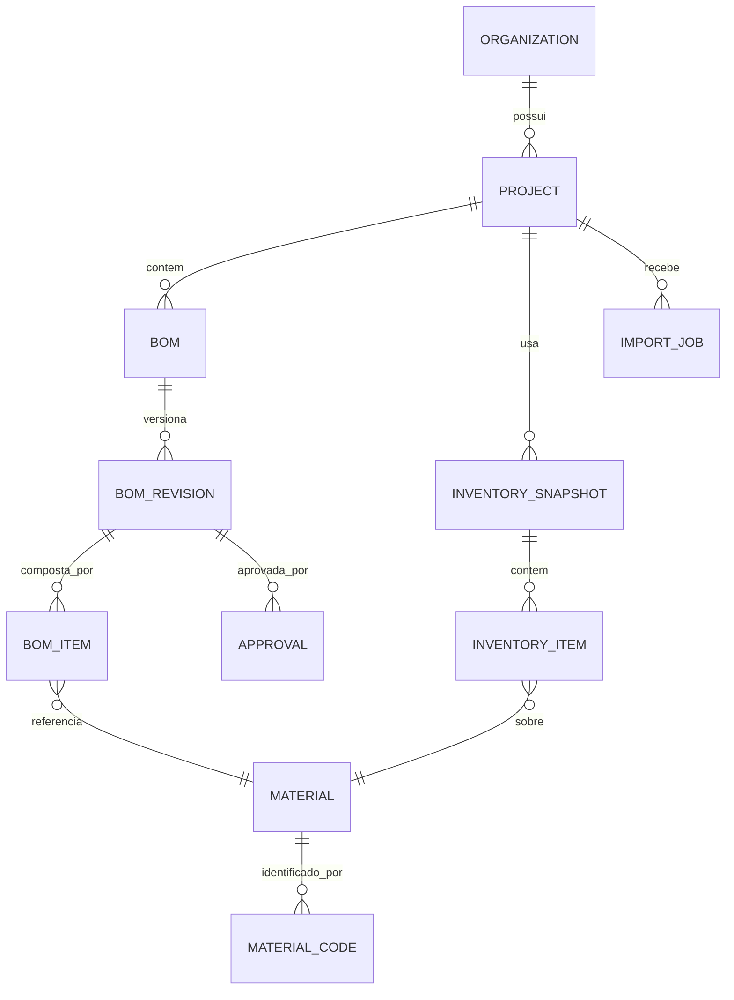

# EngiFlow — Modelo de domínio

Status: **Proposta** (Fase 0). Nomes em inglês no código; termos de negócio em português entre parênteses.

## Agregados principais

**Organization** (organização) — isolamento lógico de todos os dados. Todo agregado possui `organization_id`.

**Project** (projeto) — produto ou montagem em engenharia. Possui revisões, responsáveis, família de produto, status e **política de regras** (reserva de estoque, classificação, política de kit/compra vs. fabricação). Regras são dados do projeto, não constantes do código.

**Material** (material) — item cadastrado. Identificadores separados: código interno, ERP, CAD, fabricante. Código é sempre texto. Possui `normalized_description` e origem da informação.

**MaterialCode** — código de um material em um sistema de origem (ERP, CAD, fabricante), com `source_system` e unicidade por (organização, sistema, código).

**BOM** e **BOMRevision** — estrutura. Cada revisão é imutável após aprovação; alterações geram nova revisão.

**BOMItem** — aresta pai→filho com `quantity` (Decimal), `unit`, `position`, `kind` (fabricado, comprado, submontagem, kit).

**InventorySnapshot** e **InventoryItem** — saldo por data, filial e armazém, com quantidades disponível e reservada.

**ImportJob** / **ImportSource** — arquivo de origem, hash, mapeamento de colunas, resultado por linha.

**Execution** (job, tentativa, execução de workflow) — ver `WORKFLOW_ENGINE.md`.

**Approval** — decisão humana vinculada a um objeto e a uma versão específica.

**AuditEntry** — registro imutável de operação.

## Relações

## Invariantes de domínio

- **I-01** Uma BOM revisão não pode conter ciclo (grafo dirigido acíclico). Verificação na importação e na alteração.
- **I-02** Quantidade é `Decimal` com escala explícita; nunca `float`.
- **I-03** Código de material é texto; comparação de código preserva zeros à esquerda.
- **I-04** Revisão aprovada é imutável; alteração cria nova revisão.
- **I-05** Equivalência entre materiais só é confirmada por ação humana registrada; sugestão automática tem status `pending_review`.
- **I-06** Duplicidade de código dentro de um sistema de origem gera alerta, nunca exclusão automática.
- **I-07** Necessidade acumulada = soma, sobre todos os caminhos da raiz até o componente, do produto das quantidades × número de unidades da raiz. Caminhos são contados uma vez por ocorrência.
- **I-08** Quando um kit e seus componentes aparecem simultaneamente, a política do projeto define se a compra é do kit, dos componentes ou se o kit é apenas agrupamento. A política precisa ser explícita; sem política configurada, o sistema bloqueia o cálculo de compra e pede configuração.

## Conceitos de quantidade (distinguir sempre)

| Conceito | Definição |
|---|---|
| Por montagem | Quantidade na aresta pai→filho |
| Acumulada | Total do componente por unidade da raiz |
| Por kit | Acumulada restrita a um kit |
| Por chassi | Acumulada × número de chassis |
| Por ordem de produção | Acumulada × quantidade da ordem |
| Por lote | Análogo à ordem, para lote de produção |

## Pontos ainda não modelados

- Unidades de medida com conversão (ex.: metro → barra). Fora do MVP; registrado como pendência.
- Variantes/opções de configuração de produto. Pendente de definição com a engenharia.
- Estruturas "fantasma" (phantom). Pendente.
