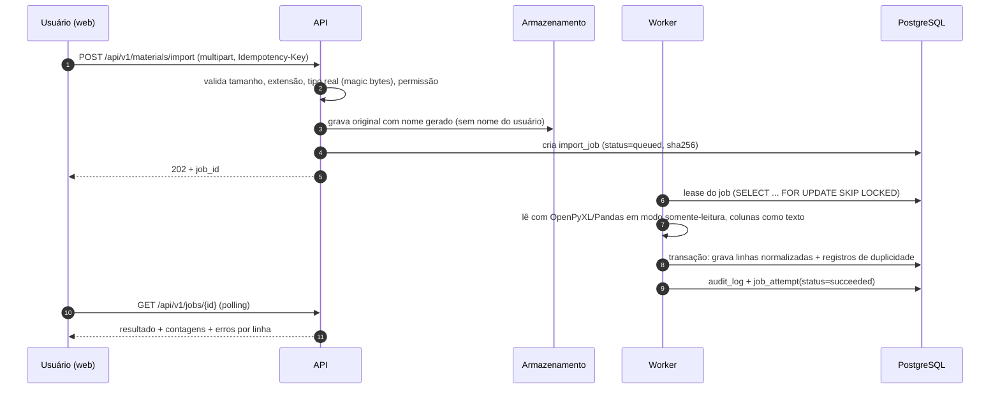
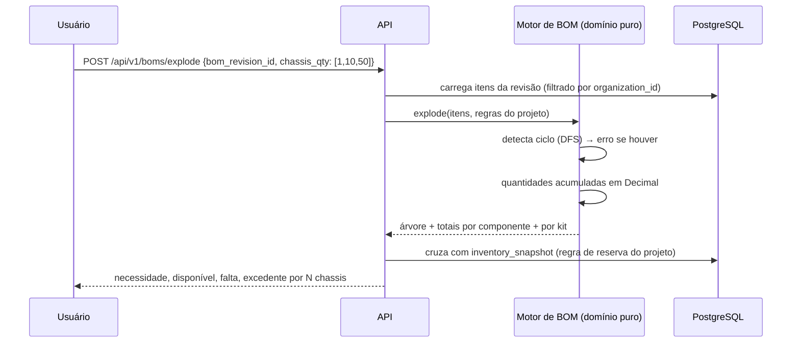
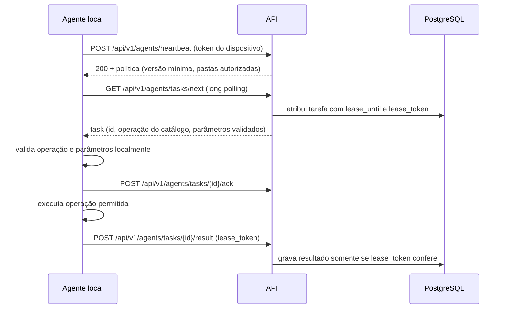
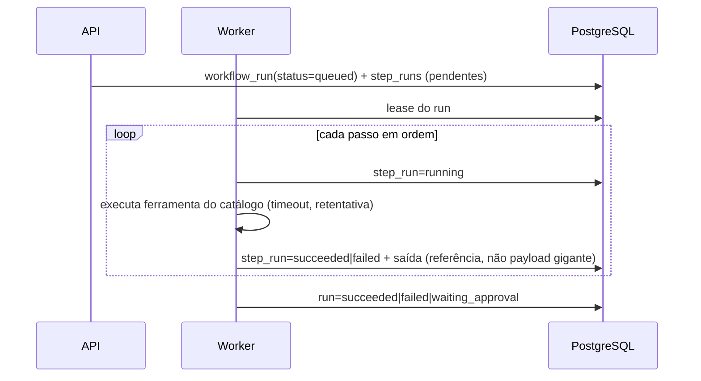

# EngiFlow — Design de sistema (sequências)

Status: **Proposta** (Fase 0).

## 1. Importação de planilha (síncrona para arquivos pequenos, assíncrona para grandes)

## 2. Expansão de BOM e cálculo por chassi

Cálculo é função determinística de domínio, testada com fixtures; IA não participa.

## 3. Comunicação com agente local (polling com lease)

Se o lease expirar sem resultado, a tarefa volta a `queued` com novo `attempt`; resultados tardios com token antigo são rejeitados (ver `LOCAL_AGENT_DESIGN.md`).

## 4. Workflow (execução linear)

## 5. Limites de execução

| Operação | Síncrona | Assíncrona |
|---|---|---|
| Consulta de projeto/BOM pequena | sim | — |
| Importação de arquivo | até limite definido em `DEPLOYMENT.md` | acima do limite |
| Exportação | arquivos pequenos | sempre |
| Varredura de pasta autorizada | — | sempre (agente) |

Limites numéricos de tamanho e tempo: **a definir** após teste de carga com volume real.
